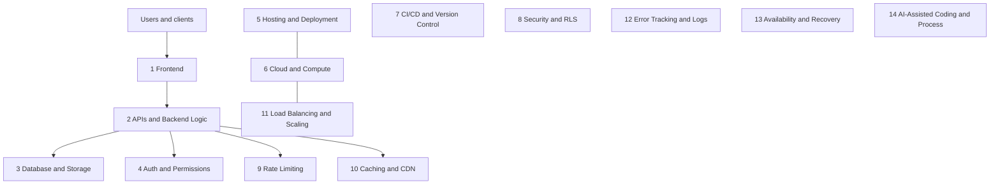

# Awesome Grok Bot Skills

A curated list of agent skills for [Grok Bot](https://grok.com), plus original starter skills in Grok Bot format.

The index is inspired by, and drawn from, [sergebulaev/awesome-agent-skills](https://github.com/sergebulaev/awesome-agent-skills) — a hand-picked collection of official and community Agent Skills (also associated with [VoltAgent/awesome-agent-skills](https://github.com/VoltAgent/awesome-agent-skills)). This repository does **not** copy those skill texts. Each index entry links to the **original source** listed upstream. Third-party skills keep **their own licenses**.

This repository's original content (starter skills, the fullstack skill, docs, and this list's wording) is [MIT-licensed](LICENSE).

## Featured: Full-Stack Vibe Coder

Social media makes coding look like typing a prompt and watching an app appear. That demo is usually just Frontend + Backend. **Production work is the whole stack.**

The original skill [`fullstack-vibe-coder`](skills/fullstack-vibe-coder/SKILL.md) is a production-readiness guide for anyone building, reviewing, or shipping a web app with AI. It covers 14 layers, with a [pre-launch gate](skills/fullstack-vibe-coder/SKILL.md#pre-launch-gate) and deeper checklists in `references/`.

Vibe coders think full-stack is Frontend + Backend. Production reality is:

| # | Layer | Reference |
| ---: | --- | --- |
| 1 | Frontend | [01-frontend.md](skills/fullstack-vibe-coder/references/01-frontend.md) |
| 2 | APIs & Backend Logic | [02-apis-backend.md](skills/fullstack-vibe-coder/references/02-apis-backend.md) |
| 3 | Database & Storage | [03-database-storage.md](skills/fullstack-vibe-coder/references/03-database-storage.md) |
| 4 | Auth & Permissions | [04-auth-permissions.md](skills/fullstack-vibe-coder/references/04-auth-permissions.md) |
| 5 | Hosting & Deployment | [05-hosting-deployment.md](skills/fullstack-vibe-coder/references/05-hosting-deployment.md) |
| 6 | Cloud & Compute | [06-cloud-compute.md](skills/fullstack-vibe-coder/references/06-cloud-compute.md) |
| 7 | CI/CD & Version Control | [07-cicd-version-control.md](skills/fullstack-vibe-coder/references/07-cicd-version-control.md) |
| 8 | Security & RLS | [08-security-rls.md](skills/fullstack-vibe-coder/references/08-security-rls.md) |
| 9 | Rate Limiting | [09-rate-limiting.md](skills/fullstack-vibe-coder/references/09-rate-limiting.md) |
| 10 | Caching & CDN | [10-caching-cdn.md](skills/fullstack-vibe-coder/references/10-caching-cdn.md) |
| 11 | Load Balancing & Scaling | [11-load-balancing-scaling.md](skills/fullstack-vibe-coder/references/11-load-balancing-scaling.md) |
| 12 | Error Tracking & Logs | [12-error-tracking-logs.md](skills/fullstack-vibe-coder/references/12-error-tracking-logs.md) |
| 13 | Availability & Recovery | [13-availability-recovery.md](skills/fullstack-vibe-coder/references/13-availability-recovery.md) |
| 14 | AI-Assisted Coding & Process | [14-ai-process.md](skills/fullstack-vibe-coder/references/14-ai-process.md) |



Topic coverage (every item from the source list, plus extras such as SPF/DKIM/DMARC and payment webhook idempotency) is in [COVERAGE.md](skills/fullstack-vibe-coder/COVERAGE.md).

## What a Grok Bot skill looks like

A skill is a `SKILL.md` file with YAML frontmatter (`name` and `description`) and instructions. The `description` is the one-line **when to use** signal an agent matches against. Put deeper notes in sibling `references/` files and tell the agent when to open them.

```markdown
---
name: example-skill
description: When the user asks for X, use this skill to do Y.
---

# Example skill

Steps the agent should follow...
```

## How to install a skill in Grok Bot

1. Open the skill's `SKILL.md` (and any `references/` it links to).
2. Add it as a custom skill in Grok Bot — paste the file, or copy the folder into the bot's skills library if you maintain skills as files.
3. Keep the frontmatter intact. For `fullstack-vibe-coder`, copy the whole `skills/fullstack-vibe-coder/` directory so the reference files travel with it.
4. Restart or refresh the bot if it caches the skill list. Ask it a question that should trigger the `description`.

Official skills from other tools (Claude Code, Codex, Cursor, and so on) often use the same `SKILL.md` shape. You can usually point Grok Bot at the upstream file as a starting point; you may still need to adapt tool names and paths.

## Starter skills in this repo

Original skills written for this project live under [`skills/`](skills/README.md):

- [fullstack-vibe-coder](skills/fullstack-vibe-coder/SKILL.md) — production-ready full-stack reviews (featured above)
- [code-review](skills/code-review/SKILL.md)
- [write-pr-description](skills/write-pr-description/SKILL.md)
- [bug-triage](skills/bug-triage/SKILL.md)
- [api-docs-writer](skills/api-docs-writer/SKILL.md)
- [data-csv-analysis](skills/data-csv-analysis/SKILL.md)
- [landing-page-copy](skills/landing-page-copy/SKILL.md)
- [seo-audit](skills/seo-audit/SKILL.md)
- [linkedin-post-humanizer](skills/linkedin-post-humanizer/SKILL.md)
- [x-thread-writer](skills/x-thread-writer/SKILL.md)
- [competitor-research](skills/competitor-research/SKILL.md)
- [meeting-notes-to-actions](skills/meeting-notes-to-actions/SKILL.md)
- [cold-email-draft](skills/cold-email-draft/SKILL.md) — draft only, never auto-send

## Curated index

115 high-quality entries across 10 categories, selected from [sergebulaev/awesome-agent-skills](https://github.com/sergebulaev/awesome-agent-skills). Official team skills are preferred; near-duplicates from the same org are limited. Links are the URLs from that README (GitHub or [officialskills.sh](https://officialskills.sh) catalog pages). If a link dies, please open a PR to drop or fix it.

### Contents

- [Coding and dev tools](#coding-and-dev-tools) (27)
- [Cloud and deploy](#cloud-and-deploy) (8)
- [Data and analysis](#data-and-analysis) (9)
- [Documents and office](#documents-and-office) (10)
- [Design](#design) (15)
- [Marketing and social growth](#marketing-and-social-growth) (8)
- [Research](#research) (6)
- [Productivity](#productivity) (11)
- [Security](#security) (6)
- [AI and agents](#ai-and-agents) (15)

## Coding and dev tools

- [vercel-labs/react-best-practices](https://officialskills.sh/vercel-labs/skills/react-best-practices) — React best practices and patterns. Author: Vercel.
- [vercel-labs/next-best-practices](https://officialskills.sh/vercel-labs/skills/next-best-practices) — Next.js best practices and recommended patterns. Author: Vercel.
- [vercel-labs/composition-patterns](https://officialskills.sh/vercel-labs/skills/composition-patterns) — React component composition and reusable patterns. Author: Vercel.
- [callstackincubator/react-native-best-practices](https://officialskills.sh/callstackincubator/skills/react-native-best-practices) — Performance optimization for React Native apps from Callstack. Author: Callstack.
- [callstackincubator/github](https://officialskills.sh/callstackincubator/skills/github) — GitHub workflow patterns for PRs, code review, branching. Author: Callstack.
- [expo/building-native-ui](https://officialskills.sh/expo/skills/building-native-ui) — Build apps with Expo Router, styling, components, navigation, and animations. Author: Expo.
- [expo/expo-deployment](https://officialskills.sh/expo/skills/expo-deployment) — Deploy Expo apps to production. Author: Expo.
- [better-auth/best-practices](https://officialskills.sh/better-auth/skills/best-practices) — Best practices for Better Auth integration. Author: Better Auth.
- [getsentry/code-review](https://officialskills.sh/getsentry/skills/code-review) — Perform code reviews. Author: Sentry.
- [getsentry/create-pr](https://officialskills.sh/getsentry/skills/create-pr) — Create pull requests. Author: Sentry.
- [getsentry/find-bugs](https://officialskills.sh/getsentry/skills/find-bugs) — Find and identify bugs in code. Author: Sentry.
- [stripe/stripe-best-practices](https://officialskills.sh/stripe/skills/stripe-best-practices) — Best practices for building Stripe integrations. Author: Stripe.
- [hashicorp/terraform-style-guide](https://officialskills.sh/hashicorp/skills/terraform-style-guide) — Generate Terraform HCL code following HashiCorp's official style conventions. Author: HashiCorp.
- [antonbabenko/terraform-skill](https://github.com/antonbabenko/terraform-skill) — Terraform infrastructure as code best practices. Author: Anton Babenko.
- [flutter/flutter-architecting-apps](https://officialskills.sh/flutter/skills/flutter-architecting-apps) — Structure a Flutter app using layered architecture. Author: Flutter.
- [flutter/flutter-improving-accessibility](https://officialskills.sh/flutter/skills/flutter-improving-accessibility) — Configure Flutter for screen readers and assistive tech. Author: Flutter.
- [apollographql/graphql-schema](https://officialskills.sh/apollographql/skills/graphql-schema) — Reference guide for designing clean, evolvable GraphQL schemas. Author: Apollo GraphQL.
- [apollographql/apollo-server](https://officialskills.sh/apollographql/skills/apollo-server) — Build GraphQL servers using Apollo Server 5. Author: Apollo GraphQL.
- [firebase/firebase-auth-basics](https://officialskills.sh/firebase/skills/firebase-auth-basics) — Set up Firebase Authentication with sign-in providers. Author: Firebase.
- [firebase/firebase-security-rules-auditor](https://officialskills.sh/firebase/skills/firebase-security-rules-auditor) — Audit Firestore security rules and flag risky patterns. Author: Firebase.
- [WordPress/wp-plugin-development](https://officialskills.sh/WordPress/skills/wp-plugin-development) — Plugin architecture, hooks, settings API, security. Author: WordPress.
- [auth0/auth0-quickstart](https://officialskills.sh/auth0/skills/auth0-quickstart) — Detect your framework and scaffold Auth0 integration automatically. Author: Auth0.
- [obra/test-driven-development](https://github.com/obra/superpowers/blob/main/skills/test-driven-development/SKILL.md) — Write tests before implementing code. Author: obra (superpowers).
- [obra/systematic-debugging](https://github.com/obra/superpowers/blob/main/skills/systematic-debugging/SKILL.md) — Methodical problem-solving in code. Author: obra (superpowers).
- [testdino-hq/playwright-skill](https://github.com/testdino-hq/playwright-skill) — 70+ production-tested Playwright automation testing patterns: E2E, POM, CI/CD, migrations, CLI. Author: TestDino.
- [mcollina/skills](https://github.com/mcollina/skills/tree/main/skills) — 11 skills by Matteo Collina: Node.js, Fastify, TypeScript, OAuth, Git/GitHub, ESLint neostandard, documentation (Diataxis), Node.js core internals, skill optimizer, and more. Author: Matteo Collina.
- [openai/gh-fix-ci](https://officialskills.sh/openai/skills/gh-fix-ci) — Debug and fix failing GitHub Actions PR checks using log inspection. Author: OpenAI.

## Cloud and deploy

- [cloudflare/wrangler](https://officialskills.sh/cloudflare/skills/wrangler) — Deploy and manage Workers, KV, R2, D1, Vectorize, Queues, Workflows. Author: Cloudflare.
- [cloudflare/web-perf](https://officialskills.sh/cloudflare/skills/web-perf) — Audit Core Web Vitals and render-blocking resources. Author: Cloudflare.
- [netlify/netlify-cli-and-deploy](https://officialskills.sh/netlify/skills/netlify-cli-and-deploy) — CLI setup, local dev, and deployment workflows. Author: Netlify.
- [netlify/netlify-functions](https://officialskills.sh/netlify/skills/netlify-functions) — Build serverless API endpoints and background tasks. Author: Netlify.
- [vercel-labs/next-cache-components](https://officialskills.sh/vercel-labs/skills/next-cache-components) — Caching strategies and cache-aware components in Next.js. Author: Vercel.
- [hashicorp/terraform-stacks](https://officialskills.sh/hashicorp/skills/terraform-stacks) — Manage infrastructure across multiple environments, regions, and cloud accounts. Author: HashiCorp.
- [firebase/firebase-app-hosting-basics](https://officialskills.sh/firebase/skills/firebase-app-hosting-basics) — Deploy and manage full-stack web apps (Next.js, Angular, etc.). Author: Firebase.
- [openai/cloudflare-deploy](https://officialskills.sh/openai/skills/cloudflare-deploy) — Deploy apps to Cloudflare using Workers, Pages, and platform services. Author: OpenAI.

## Data and analysis

- [supabase/postgres-best-practices](https://officialskills.sh/supabase/skills/postgres-best-practices) — PostgreSQL best practices for Supabase. Author: Supabase.
- [neondatabase/neon-postgres](https://officialskills.sh/neondatabase/skills/neon-postgres) — Best practices for Neon Serverless Postgres. Author: Neon.
- [clickhouse/clickhouse-best-practices](https://officialskills.sh/clickhouse/skills/clickhouse-best-practices) — Best practices for working with ClickHouse. Author: ClickHouse.
- [duckdb/query](https://officialskills.sh/duckdb/skills/query) — Run SQL queries against attached databases or ad-hoc against files using Friendly SQL dialect. Author: DuckDB.
- [duckdb/read-file](https://officialskills.sh/duckdb/skills/read-file) — Read any data file (CSV, JSON, Parquet, Avro, Excel, spatial) locally or from remote storage. Author: DuckDB.
- [mongodb/mongodb-schema-design](https://officialskills.sh/mongodb/skills/mongodb-schema-design) — Design efficient document schemas with validation and indexing patterns. Author: MongoDB.
- [tinybirdco/tinybird-best-practices](https://officialskills.sh/tinybirdco/skills/tinybird-best-practices) — Tinybird project guidelines for datasources, pipes, endpoints, and SQL. Author: Tinybird.
- [huggingface/hugging-face-datasets](https://officialskills.sh/huggingface/skills/hugging-face-datasets) — Create and manage datasets with configs and SQL querying. Author: Hugging Face.
- [qdrant/skills](https://github.com/qdrant/skills) — Agent skills for Qdrant vector search, covering scaling, performance optimization, search quality, monitoring, deployment, model migration, version upgrades, and SDK usage across Python, TypeScript, Rust, Go, .NET, and Java. Author: Qdrant.

## Documents and office

- [anthropics/docx](https://officialskills.sh/anthropics/skills/docx) — Create, edit, and analyze Word documents. Author: Anthropic.
- [anthropics/pptx](https://officialskills.sh/anthropics/skills/pptx) — Create, edit, and analyze PowerPoint presentations. Author: Anthropic.
- [anthropics/xlsx](https://officialskills.sh/anthropics/skills/xlsx) — Create, edit, and analyze Excel spreadsheets. Author: Anthropic.
- [anthropics/pdf](https://officialskills.sh/anthropics/skills/pdf) — Extract text, create PDFs, and handle forms. Author: Anthropic.
- [anthropics/doc-coauthoring](https://officialskills.sh/anthropics/skills/doc-coauthoring) — Collaborative document editing and co-authoring. Author: Anthropic.
- [googleworkspace/gws-docs](https://officialskills.sh/googleworkspace/skills/gws-docs) — Read and write Google Docs documents. Author: Google Workspace.
- [googleworkspace/gws-sheets](https://officialskills.sh/googleworkspace/skills/gws-sheets) — Read and write Google Sheets spreadsheets. Author: Google Workspace.
- [googleworkspace/gws-slides](https://officialskills.sh/googleworkspace/skills/gws-slides) — Read and write Google Slides presentations. Author: Google Workspace.
- [googleworkspace/gws-drive](https://officialskills.sh/googleworkspace/skills/gws-drive) — Manage Google Drive files, folders, and shared drives. Author: Google Workspace.
- [openai/doc](https://officialskills.sh/openai/skills/doc) — Read, create, and edit .docx documents with formatting and layout fidelity. Author: OpenAI.

## Design

- [anthropics/frontend-design](https://officialskills.sh/anthropics/skills/frontend-design) — Frontend design and UI/UX development tools. Author: Anthropic.
- [anthropics/canvas-design](https://officialskills.sh/anthropics/skills/canvas-design) — Design visual art in PNG and PDF formats. Author: Anthropic.
- [anthropics/theme-factory](https://officialskills.sh/anthropics/skills/theme-factory) — Style artifacts with professional themes or generate custom themes. Author: Anthropic.
- [vercel-labs/web-design-guidelines](https://officialskills.sh/vercel-labs/skills/web-design-guidelines) — Web design guidelines and standards. Author: Vercel.
- [google-labs-code/design-md](https://officialskills.sh/google-labs-code/skills/design-md) — Create and manage DESIGN.md files. Author: Google Labs.
- [google-labs-code/shadcn-ui](https://officialskills.sh/google-labs-code/skills/shadcn-ui) — Build UI components with shadcn/ui. Author: Google Labs.
- [google-labs-code/stitch-loop](https://officialskills.sh/google-labs-code/skills/stitch-loop) — Iterative design-to-code feedback loop. Author: Google Labs.
- [figma/figma-implement-design](https://officialskills.sh/figma/skills/figma-implement-design) — Translate Figma designs into production-ready application code with 1:1 fidelity. Author: Figma.
- [figma/figma-generate-design](https://officialskills.sh/figma/skills/figma-generate-design) — Build or update screens in Figma from code or description using design system components. Author: Figma.
- [microsoft/frontend-design-review](https://officialskills.sh/microsoft/skills/frontend-design-review) — Review and create distinctive frontend interfaces. Author: Microsoft.
- [addyosmani/web-quality-audit](https://officialskills.sh/addyosmani/skills/web-quality-audit) — Comprehensive quality review across performance, accessibility, SEO, and best practices categories. Author: Addy Osmani.
- [addyosmani/accessibility](https://officialskills.sh/addyosmani/skills/accessibility) — WCAG compliance, screen reader support, and keyboard navigation. Author: Addy Osmani.
- [addyosmani/core-web-vitals](https://officialskills.sh/addyosmani/skills/core-web-vitals) — LCP, INP, and CLS-specific optimizations. Author: Addy Osmani.
- [remotion-dev/remotion](https://officialskills.sh/remotion-dev/skills/remotion) — Programmatic video creation with React. Author: Remotion.
- [greensock/gsap-core](https://officialskills.sh/greensock/skills/gsap-core) — Core API with gsap.to(), from(), fromTo(), easing, duration, stagger, and defaults. Author: GSAP (GreenSock).

## Marketing and social growth

- [typefully/typefully](https://officialskills.sh/typefully/skills/typefully) — Create, schedule, and publish social media content across X, LinkedIn, Threads, Bluesky, and Mastodon. Author: Typefully.
- [coreyhaines31/ai-seo](https://github.com/coreyhaines31/marketingskills/tree/main/skills/ai-seo) — Optimize content to appear in AI-generated answers and LLM search results. Author: Corey Haines.
- [coreyhaines31/ad-creative](https://github.com/coreyhaines31/marketingskills/tree/main/skills/ad-creative) — Generate and iterate ad creative including headlines, descriptions, and primary text. Author: Corey Haines.
- [AgriciDaniel/claude-seo](https://github.com/AgriciDaniel/claude-seo) — Universal SEO skill for comprehensive website analysis and optimization. Author: AgriciDaniel.
- [blader/humanizer](https://github.com/blader/humanizer) — Remove signs of AI-generated writing from text, making it sound more natural and human. Author: blader.
- [resend/email-best-practices](https://github.com/resend/resend-skills/tree/main/skills/email-best-practices) — Email deliverability and design best practices. Author: Resend.
- [addyosmani/seo](https://officialskills.sh/addyosmani/skills/seo) — Search engine optimization, crawlability, and structured data. Author: Addy Osmani.
- [BrianRWagner/ai-marketing-skills](https://github.com/BrianRWagner/ai-marketing-skills) — 17 marketing frameworks for cold outreach, homepage audit, social cards, and more. Author: Brian R. Wagner.

## Research

- [firecrawl/firecrawl-scrape](https://officialskills.sh/firecrawl/skills/firecrawl-scrape) — Scrape web pages and extract content. Author: Firecrawl.
- [firecrawl/firecrawl-search](https://officialskills.sh/firecrawl/skills/firecrawl-search) — Search the web and extract results. Author: Firecrawl.
- [brave/answers](https://officialskills.sh/brave/skills/answers) — AI-generated answers grounded in live web search results. Author: Brave.
- [browserbase/search](https://officialskills.sh/browserbase/skills/search) — Search the web via the Browserbase API with structured results. Author: Browserbase.
- [K-Dense-AI/claude-scientific-skills](https://github.com/K-Dense-AI/claude-scientific-skills) — Scientific research and analysis skills. Author: K-Dense-AI.
- [deanpeters/company-research](https://github.com/deanpeters/Product-Manager-Skills/tree/main/skills/company-research) — Deep-dive competitor or company analysis. Author: Dean Peters.

## Productivity

- [anthropics/internal-comms](https://officialskills.sh/anthropics/skills/internal-comms) — Write status reports, newsletters, and FAQs. Author: Anthropic.
- [makenotion/meeting-intelligence](https://officialskills.sh/makenotion/skills/meeting-intelligence) — Prepare meeting materials by gathering Notion context and creating pre-reads and agendas. Author: Notion.
- [makenotion/knowledge-capture](https://officialskills.sh/makenotion/skills/knowledge-capture) — Transform conversations into structured Notion documentation pages with proper organization and linking. Author: Notion.
- [googleworkspace/gws-calendar](https://officialskills.sh/googleworkspace/skills/gws-calendar) — Manage Google Calendar calendars and events. Author: Google Workspace.
- [googleworkspace/gws-gmail](https://officialskills.sh/googleworkspace/skills/gws-gmail) — Send, read, and manage Gmail email. Author: Google Workspace.
- [garrytan/office-hours](https://officialskills.sh/garrytan/skills/office-hours) — YC Office Hours: six forcing questions that reframe your product before you write code. Author: Garry Tan (gstack).
- [garrytan/review](https://officialskills.sh/garrytan/skills/review) — Staff Engineer code review: finds bugs that pass CI but blow up in production. Author: Garry Tan (gstack).
- [deanpeters/customer-journey-map](https://github.com/deanpeters/Product-Manager-Skills/tree/main/skills/customer-journey-map) — Map customer experience across touchpoints using the NNGroup framework. Author: Dean Peters.
- [phuryn/create-prd](https://github.com/phuryn/pm-skills/tree/main/pm-execution/skills/create-prd) — Create a PRD with 8-section template covering problem to release. Author: Paweł Huryn.
- [phuryn/pre-mortem](https://github.com/phuryn/pm-skills/tree/main/pm-execution/skills/pre-mortem) — Run pre-mortem risk analysis on PRDs and launch plans. Author: Paweł Huryn.
- [openai/linear](https://officialskills.sh/openai/skills/linear) — Manage issues, projects, and team workflows in Linear. Author: OpenAI.

## Security

- [trailofbits/insecure-defaults](https://officialskills.sh/trailofbits/skills/insecure-defaults) — Detect insecure default configurations like hardcoded secrets, default credentials, and weak crypto. Author: Trail of Bits.
- [trailofbits/differential-review](https://officialskills.sh/trailofbits/skills/differential-review) — Security-focused diff review with git history analysis. Author: Trail of Bits.
- [trailofbits/static-analysis](https://officialskills.sh/trailofbits/skills/static-analysis) — Static analysis toolkit with CodeQL, Semgrep, and SARIF. Author: Trail of Bits.
- [trailofbits/sharp-edges](https://officialskills.sh/trailofbits/skills/sharp-edges) — Identify error-prone APIs and dangerous configurations. Author: Trail of Bits.
- [trailofbits/building-secure-contracts](https://officialskills.sh/trailofbits/skills/building-secure-contracts) — Smart contract security toolkit with vulnerability scanners for 6 blockchains. Author: Trail of Bits.
- [better-auth/twoFactor](https://officialskills.sh/better-auth/skills/twoFactor) — Two-factor authentication with Better Auth. Author: Better Auth.

## AI and agents

- [anthropics/mcp-builder](https://officialskills.sh/anthropics/skills/mcp-builder) — Create MCP servers to integrate external APIs and services. Author: Anthropic.
- [anthropics/skill-creator](https://officialskills.sh/anthropics/skills/skill-creator) — Guide for creating skills that extend Claude's capabilities. Author: Anthropic.
- [anthropics/webapp-testing](https://officialskills.sh/anthropics/skills/webapp-testing) — Test local web applications using Playwright. Author: Anthropic.
- [voltagent/voltagent-best-practices](https://officialskills.sh/voltagent/skills/voltagent-best-practices) — Architecture and usage patterns for agents, workflows, memory, and servers. Author: VoltAgent.
- [composiohq/composio](https://officialskills.sh/composiohq/skills/composio) — Connect AI agents to 1000+ external apps with managed authentication. Author: Composio.
- [google-gemini/gemini-api-dev](https://officialskills.sh/google-gemini/skills/gemini-api-dev) — Best practices for developing Gemini-powered apps using the Gemini API. Author: Google Gemini.
- [cloudflare/agents-sdk](https://officialskills.sh/cloudflare/skills/agents-sdk) — Build stateful AI agents with scheduling, RPC, and MCP servers. Author: Cloudflare.
- [cloudflare/building-mcp-server-on-cloudflare](https://officialskills.sh/cloudflare/skills/building-mcp-server-on-cloudflare) — Build remote MCP servers with tools and OAuth. Author: Cloudflare.
- [microsoft/mcp-builder](https://officialskills.sh/microsoft/skills/mcp-builder) — MCP server creation guide for LLM tool integration. Author: Microsoft.
- [huggingface/hugging-face-model-trainer](https://officialskills.sh/huggingface/skills/hugging-face-model-trainer) — Train models with TRL: SFT, DPO, GRPO, GGUF conversion. Author: Hugging Face.
- [huggingface/transformers.js](https://officialskills.sh/huggingface/skills/transformers.js) — Run ML models in the browser with Transformers.js. Author: Hugging Face.
- [replicate/replicate](https://officialskills.sh/replicate/skills/replicate) — Discover, compare, and run AI models using Replicate's API. Author: Replicate.
- [fal-ai-community/fal-generate](https://officialskills.sh/fal-ai-community/skills/fal-generate) — Generate images and videos using fal.ai AI models. Author: fal.ai.
- [muratcankoylan/context-fundamentals](https://github.com/muratcankoylan/Agent-Skills-for-Context-Engineering/tree/main/skills/context-fundamentals) — Understand what context is, why it matters, and the anatomy of context in agent systems. Author: Muratcan Koylan.
- [muratcankoylan/multi-agent-patterns](https://github.com/muratcankoylan/Agent-Skills-for-Context-Engineering/tree/main/skills/multi-agent-patterns) — Master orchestrator, peer-to-peer, and hierarchical multi-agent architectures. Author: Muratcan Koylan.

## Contributing

Please read [CONTRIBUTING.md](CONTRIBUTING.md). New index entries must link to the original source and credit the author. New starter skills must be original wording, with no secrets or personal data.

## License

[MIT](LICENSE) for the original content of this repository (this README's wording, starter skills, and docs).

Skills linked from the index remain the property of their authors and are distributed under **their own licenses**. The upstream awesome list itself is [MIT-licensed](https://github.com/sergebulaev/awesome-agent-skills/blob/main/LICENSE) (copyright VoltAgent). Check each skill repo before you reuse its text.

## Credits

- Index inspired by and sourced from [sergebulaev/awesome-agent-skills](https://github.com/sergebulaev/awesome-agent-skills) (Serge Bulaev and contributors; see also [VoltAgent](https://github.com/VoltAgent/awesome-agent-skills)).
- Official skills remain copyright their publishers (Anthropic, Vercel, Cloudflare, Trail of Bits, and many others credited per entry).

---

Maintained by [Alizay Ayesha](https://github.com/AlizayAyesha) / [ZarLabs](https://zarlabs.online).
