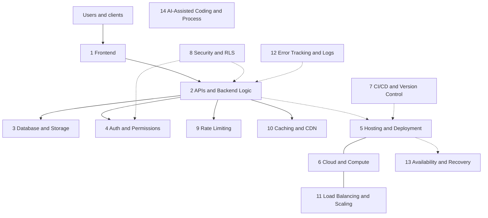

# Full-Stack Vibe Coder

Social media makes coding look like typing a prompt and watching an app appear. That demo is usually just **Frontend + Backend**. A production app is the whole stack below: auth that cannot be skipped, data that survives a crash, deploys you can roll back, limits that stop abuse, logs you can actually use, and a recovery plan for the day the database disappears.

Use this skill whenever you are **building, reviewing, or shipping** a web or full-stack app with AI. Work layer by layer. Do not treat a green local page as "done."

## The 14 layers

Vibe coders think full-stack is Frontend + Backend. Production reality is:

| # | Layer | Read the reference when… |
|---|--------|--------------------------|
| 1 | [Frontend](references/01-frontend.md) | You are building UI, styling, media, accessibility, or client performance. |
| 2 | [APIs & Backend Logic](references/02-apis-backend.md) | You are adding routes, jobs, webhooks, validation, or API contracts. |
| 3 | [Database & Storage](references/03-database-storage.md) | You are designing schema, queries, migrations, or file storage. |
| 4 | [Auth & Permissions](references/04-auth-permissions.md) | You are adding login, sessions, tokens, or protected routes. |
| 5 | [Hosting & Deployment](references/05-hosting-deployment.md) | You are deploying, configuring environments, DNS, or TLS. |
| 6 | [Cloud & Compute](references/06-cloud-compute.md) | You are choosing runtimes, regions, containers, or serverless. |
| 7 | [CI/CD & Version Control](references/07-cicd-version-control.md) | You are branching, reviewing, linting, or automating checks. |
| 8 | [Security & RLS](references/08-security-rls.md) | You are handling untrusted input, secrets, policies, or headers. |
| 9 | [Rate Limiting](references/09-rate-limiting.md) | You are exposing public endpoints or login/reset forms. |
| 10 | [Caching & CDN](references/10-caching-cdn.md) | You are speeding up reads, assets, or repeated queries. |
| 11 | [Load Balancing & Scaling](references/11-load-balancing-scaling.md) | You are running more than one instance or planning load. |
| 12 | [Error Tracking & Logs](references/12-error-tracking-logs.md) | You are adding logging, traces, alerts, or debugging production. |
| 13 | [Availability & Recovery](references/13-availability-recovery.md) | You are planning backups, uptime, incidents, or failover. |
| 14 | [AI-Assisted Coding & Process](references/14-ai-process.md) | You are generating code, writing tests, or setting team process. |

Extras that production apps commonly need (not in the original topic list) are in [references/extras.md](references/extras.md): transactional email deliverability, payments and webhook idempotency, i18n, SEO basics, analytics consent, legal pages, and env-specific config.

Topic-to-layer map: [COVERAGE.md](COVERAGE.md).

## How to use this skill

1. Read this file first. Keep the 14-layer table in mind while you plan or review.
2. When work touches a layer, **open that layer's reference file** and follow its checklist. Do not rely on memory of this overview.
3. After implementing, run the **Quick verification** commands in that reference.
4. Before a production launch or a "ship it" review, walk the **Pre-launch gate** below and open any layer that is still unchecked.
5. If the user is only asking about one area (for example, login), still glance at adjacent layers (auth, security, rate limiting, cookies, email).

## Layer checklists

Each block is a short filter, not the full guide. Open the reference for the concrete checks.

### 1. Frontend — [references/01-frontend.md](references/01-frontend.md)

- Semantic HTML, keyboard access, visible focus, labels, and contrast (Accessibility). Layouts must work on a 320px viewport with usable tap targets (Mobile Responsiveness).
- Set Performance Budgets for JS/CSS weight and Core Web Vitals; optimize images and video rather than shipping raw media.
- Use UTF-8 Character Encoding everywhere. Store instants in UTC and display Time Zones explicitly.

Common vibe-coding mistakes: hover-only controls, missing `alt` and form labels, huge unresized PNGs, layout shift from images without width/height, formatting dates as "server local time."

### 2. APIs & Backend Logic — [references/02-apis-backend.md](references/02-apis-backend.md)

- Validate on the server (Input Validation and Server-Side Data Validation). Never trust the client. Return accurate HTTP Status Codes and safe Error Handling.
- Set Timeouts, Retries with Exponential Backoff, Idempotency keys, and Circuit Breakers on outbound calls. Configure CORS explicitly; do not use `*` with credentials.
- Be deliberate about REST, GraphQL, or WebSockets. Version and document the API. Put slow work on Background Jobs, Cron Jobs, Message Queues, and verified Webhooks.
- Use Feature Flags for risky rollouts. Paginate every list. Profile Concurrency, Async/Await, Memory Leaks, and hot paths.

Common vibe-coding mistakes: `200 OK` for every failure, unauthenticated "admin" query params, retries that double-charge, webhook handlers that are not idempotent, loading the entire table in one response.

### 3. Database & Storage — [references/03-database-storage.md](references/03-database-storage.md)

- Design Schema Design with Primary Keys, Foreign Keys, Unique Constraints, and Database Constraints. Choose SQL vs NoSQL on purpose. Index what you query (Database Indexing); confirm with Query Plans (EXPLAIN).
- Wrap multi-step writes in Transactions with a clear Isolation Level. Avoid N+1 Queries, unbounded Connection Pooling, and accidental Race Conditions or Deadlocks.
- Ship Database Migrations and Data Migration Scripts that are backward compatible (Zero-Downtime Migrations). Prefer Cursor-Based Pagination for stable lists.
- Use Object Storage and Presigned URLs for user files, not the git repo. Define Soft Deletes and Data Retention Policies before you need them.

Common vibe-coding mistakes: no migrations ("I'll edit prod by hand"), missing indexes on foreign keys, `SELECT *` in a loop, offset pagination that duplicates rows, storing uploads in `public/`.

### 4. Auth & Permissions — [references/04-auth-permissions.md](references/04-auth-permissions.md)

- Authentication proves identity; Authorization checks every action. Hash passwords with a slow algorithm plus unique Salting. Know Hashing vs Encryption — password hashes must not be reversible.
- Prefer server sessions or carefully rotated JWTs. Implement OAuth, SSO, Passkeys, Magic Links, and Two-Factor Authentication correctly if you offer them.
- Email Verification and Password Reset Flows must use secret, single-use, short-lived tokens. Set Cookie Flags (HttpOnly/Secure/SameSite). Expire and refresh tokens; lock out after abuse (Account Lockout).
- Enforce Role-Based Access Control and the Principle of Least Privilege. Block IDOR and Mass Assignment. Treat API Keys as secrets, not as a substitute for user auth.

Common vibe-coding mistakes: checking the role only in the UI, JWTs that never expire, reset links that are guessable or reusable, putting tokens in `localStorage`, trusting a client-sent `user_id`.

### 5. Hosting & Deployment — [references/05-hosting-deployment.md](references/05-hosting-deployment.md)

- Keep Environment Variables and config out of the image and the client bundle. Use Staging Environments and Environment Parity. Practice Rollbacks, Rolling Deployments, or Blue-Green Deployments before you need them.
- Package with Docker / Docker Compose when it helps, but define Health Checks and Graceful Shutdown. Manage Domain Names, DNS, HTTPS/TLS, and SSL Certificate Renewal.
- Prefer Infrastructure as Code. Watch Vendor Lock-In when you adopt proprietary services. Configuration Management should be explicit per environment.

Common vibe-coding mistakes: shipping `.env` with secrets, "deploy" being `scp` of `node_modules`, no staging, no rollback plan, TLS only on the marketing domain.

### 6. Cloud & Compute — [references/06-cloud-compute.md](references/06-cloud-compute.md)

- Choose Containers vs VMs, Kubernetes, or Serverless Functions based on workload, not hype. Plan for Cold Starts, Edge Computing limits, and Regions and Availability Zones.
- Put private resources in VPCs. Watch Cost Monitoring from day one (idle instances, chatty APIs, unattended logs and egress).

Common vibe-coding mistakes: a single region with no failover story, serverless functions that hide a 30s cold start on the login path, unbounded cloud spend with no budget alarm.

### 7. CI/CD & Version Control — [references/07-cicd-version-control.md](references/07-cicd-version-control.md)

- Use Git with a clear Branching Strategy, reviewed Pull Requests, and useful Commit Messages. Know Merge Conflicts, Rebasing, `.gitignore`, Git Tags and Releases, Changelogs, and Semantic Versioning.
- CI/CD should lint, typecheck, test, and run Security Scanning (SAST/DAST) before deploy. Add Linting, Formatting, Type Safety, and Pre-Commit Hooks so style is not a debate.
- Pin dependencies with Lockfiles and Package Managers; track License Compliance and who can publish.

Common vibe-coding mistakes: committing `.env` and `node_modules`, pushing straight to `main`, CI that only runs "build", lockfiles that are deleted "to fix conflict."

### 8. Security & RLS — [references/08-security-rls.md](references/08-security-rls.md)

- Walk the OWASP Top 10. Prevent SQL Injection, XSS, CSRF, SSRF, Path Traversal, Command Injection, Open Redirects, and unsafe File Upload Security.
- Turn on Row-Level Security for multi-tenant data — application checks alone get skipped. Set Security Headers, Content Security Policy, and anti-Clickjacking.
- Secrets Management and Secret Rotation, Encryption at Rest and Encryption in Transit, SSH Keys, Firewalls, WAF, DDoS Protection, Bot Protection, and CAPTCHA belong in the design, not a later "hardening sprint."
- Track Dependency Vulnerabilities and Supply Chain Attacks. Keep Audit Logs. Respect Data Privacy (GDPR). Schedule Penetration Testing before you store money or health data.

Common vibe-coding mistakes: string-concatenated SQL, `dangerouslySetInnerHTML` on user text, RLS disabled "just for the demo," secrets in the frontend, a public storage bucket.

### 9. Rate Limiting — [references/09-rate-limiting.md](references/09-rate-limiting.md)

- Apply Rate Limiting per user, IP, and route — especially login, signup, reset, and expensive AI endpoints. Return `429` with a retry hint.
- Brute Force Protection is more than a limiter: slowing, alerting, and optional CAPTCHA after repeated failures.

Common vibe-coding mistakes: a global limiter that one tenant can exhaust, limits only in the frontend, no limit on password reset or search.

### 10. Caching & CDN — [references/10-caching-cdn.md](references/10-caching-cdn.md)

- Use Caching, CDNs, HTTP Caching Headers, TTLs, and Compression (Gzip/Brotli) deliberately. Write down Cache Invalidation rules before you cache user-specific or permissioned data.
- Redis and other Key-Value Stores are excellent for sessions, rate counters, and short-lived results — not a second source of truth without a plan.

Common vibe-coding mistakes: caching a personalized page on a shared CDN, `Cache-Control: no-cache` on every asset, cache with no key for tenant or auth, Redis as the only copy of orders.

### 11. Load Balancing & Scaling — [references/11-load-balancing-scaling.md](references/11-load-balancing-scaling.md)

- Prefer Stateless Services behind Load Balancing and Reverse Proxies. Know Horizontal vs Vertical Scaling and when Autoscaling actually helps.
- Sessions, uploads, and cron must work when there are two instances, not one.

Common vibe-coding mistakes: in-memory sessions that randomly log people out, a single box "scaled" by adding CPU only, health checks that still route to a dying instance.

### 12. Error Tracking & Logs — [references/12-error-tracking-logs.md](references/12-error-tracking-logs.md)

- Observability is Metrics, logs, and Distributed Tracing together — not a `console.log`. Use Structured Logging, Log Levels, Correlation IDs, and defined Log Retention.
- Never write PII in Logs. Wire Error Tracking, Monitoring, Alerting, and Dashboards to symptoms people feel. Practice Debugging and Reading Error Messages before you rewrite the module.

Common vibe-coding mistakes: logging access tokens, alerts that fire 4,000 times a night and get ignored, "it failed" with no request id, only watching CPU.

### 13. Availability & Recovery — [references/13-availability-recovery.md](references/13-availability-recovery.md)

- Backups are worthless until Testing Backup Restores works. Know Point-in-Time Recovery and a written Disaster Recovery path.
- Define SLOs vs SLAs, Uptime Monitoring, Incident Response, On-Call, Runbooks, Postmortems, and a Status Page before the first outage.

Common vibe-coding mistakes: backups on the same disk as the database, never restoring, no owner for incidents, promising 99.99% with a single VM.

### 14. AI-Assisted Coding & Process — [references/14-ai-process.md](references/14-ai-process.md)

- Reviewing AI-Generated Code is mandatory. Check for Hallucinated APIs/packages, missing auth, and tests that assert nothing. Prefer TDD or at least tests beside the change.
- Cover Automated Testing: Unit vs Integration vs E2E Tests, Smoke Tests, Regression Testing, Load Testing, Mocking, Test Fixtures, Flaky Tests, and Code Coverage used as a signal, not a trophy.
- For LLM features: RAG with real citations, Streaming LLM Responses you can cancel, and Evaluating LLM Output (evals).
- Write Architecture Decision Records, Agent instructions files / READMEs (including `AGENTS.md`), useful Code Comments & Refactoring, and honest Bug Reports. Avoid Premature Abstraction. Keep Command Line Basics, Reading Documentation, and a plan for Technical Debt.

Common vibe-coding mistakes: installing a package that does not exist, skipping tests because "the model said it works," a 12-layer folder tree for three endpoints, no `AGENTS.md` so every session relearns the repo.

## Extras (beyond the original topic list)

Production apps almost always also need the items in [references/extras.md](references/extras.md):

- Transactional email deliverability: SPF, DKIM, and DMARC
- Payments and webhook idempotency
- Internationalization (i18n) and locale-aware formatting
- SEO basics for public pages
- Analytics and cookie consent
- Legal pages: privacy policy, terms, and cookie notice
- Environment-specific config (dev / staging / prod), separate accounts and keys

## Pre-launch gate

Walk this before you call the app production-ready. If any line is "not sure," open that layer's reference and verify.

- [ ] Public pages meet Accessibility and Mobile Responsiveness checks; media is optimized; typography and dates are encoded and zoned correctly. *(1)*
- [ ] Every list is paginated; every mutating endpoint validates on the server, uses the right status codes, and is safe to retry where needed. *(2)*
- [ ] Schema has constraints and indexes; migrations run cleanly; backups exist *and a restore was tested*; uploads go to object storage. *(3, 13)*
- [ ] Auth cannot be bypassed in the API; cookies are flagged correctly; reset and verification tokens expire; IDOR tests fail closed. *(4)*
- [ ] Staging exists; secrets are not in the client or git; TLS is on; health checks and a rollback path work. *(5)*
- [ ] You know the runtime, region, cost alarms, and what happens if that region dies. *(6)*
- [ ] CI runs lint, types, tests, and dependency/security scans on every pull request; `main` is protected. *(7)*
- [ ] OWASP-style review done: injection, XSS, CSRF, headers, CSP, RLS, secrets, uploads, SSRF. *(8)*
- [ ] Rate limits and brute-force protections are on login, signup, reset, and expensive routes. *(9)*
- [ ] CDN/cache rules will not leak private responses; TTLs and invalidation are documented. *(10)*
- [ ] The app works with two instances and no sticky in-memory state. *(11)*
- [ ] Errors have a tracker, correlation ids, and an alert that reaches a human; logs have no secrets or PII. *(12)*
- [ ] Uptime check is on; incident contacts, a runbook, and a status-page plan exist. *(13)*
- [ ] AI-generated code was reviewed; tests cover the launch path; no unverified packages; evals exist if you ship LLM output. *(14)*
- [ ] Extras: email auth records, payment webhook idempotency, consent and legal pages, env-specific config. *(extras)*

If this is a follow-up review, re-run only the layers you touched, then re-check the gate lines that depend on them.
